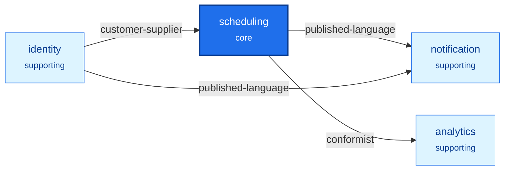

**English** · [Français](README.fr.md)

# Scheduling: the example application of ddd-ts-kit

An appointment scheduling platform for practices, built with the kit the way a user of the kit
would build it: from a one-page statement of needs, through the strategic steps of the method,
one `init` command, then the bounded contexts slice by slice, by several workers in parallel.
It exists for two things: to show what the tool yields on business rules that are not trivial
(availability across daylight-saving days, one hold per slot under concurrency, rights that
depend on relationships), and to measure honestly how the tool behaved
([docs/tooling-report.md](docs/tooling-report.md)).

Four bounded contexts in one deployable application and a worker process: `scheduling` (core),
`identity`, `notification`, `analytics`. Express, class-validator, tsyringe in the declared
style, Knex on PostgreSQL, the transactional outbox, one Redis protocol server (Dragonfly) for
the cache, the rate limiter, the job lock and the event streams, Keycloak, relationship-based
authorization combined with roles, the audit trail, pino, OpenTelemetry, the Sentry protocol,
and Varnish in front of the API.

## Headline numbers of the build

| | |
|---|---|
| From the statement of needs to a green gate and a recorded real run | about 1 h 25 min of wall clock |
| Generator runs | 213 succeeded, 27 refused |
| Files | 831: 133 generated and untouched, 584 generated then filled, 106 written by hand, 8 derived |
| Lines | 19 577 kept from generators, 21 937 written by hand (tests and documents included) |
| Markers filled | 656 `TODO(domain)`, 317 `it.todo` |
| Tests | 1 288 unit and adapter, 57 end to end; adapter tests also on PostgreSQL 18 |
| Defects found in the kit | 2, with reproductions, and 13 ranked frictions with proposals |

After delivery, `analytics` was changed to compute its figures at read time (one stored read
model instead of two, no nightly job): the numbers above are those of the build, the change and
its counts are in the last section of the tooling report.

## Run it in three commands

From the root of the repository, once (`npm ci && npm run build`), then here:

```bash
cp .env.example .env && docker compose --profile identity --profile observability up -d --wait
set -a && . ./.env && set +a && npm run db:migrate && (node dist/src/main.js & node dist/src/apps/worker/main.js &)
node --env-file=.env scripts/demo.mjs
```

The first command starts the containers, the second migrates the database and starts the two
processes of the application, the third plays the scenario of
[docs/demo-transcript.md](docs/demo-transcript.md) with real tokens of the local Keycloak.

![The two processes of the application and the containers they use: a client calls the API on port 54300, or Varnish on port 54081, which answers public reads from its cache and passes the rest to the API; the API process runs the HTTP server, the use cases of the four contexts, the event consumers, the outbox relay and the catch-up of the event store; the worker process runs the scheduled jobs and the event consumers; both use PostgreSQL, Dragonfly, Keycloak, Jaeger and GlitchTip; the relay purges Varnish by tag after a commit](https://raw.githubusercontent.com/gbourgeat/ddd-ts-kit/main/docs/assets/diagrams/scheduling-example-runtime.svg)

Everything listens on 127.0.0.1, on ports 54xxx chosen not to meet another stack:

| Open | At | Started by |
|---|---|---|
| The API, and its interactive documentation | `http://127.0.0.1:54300`, `http://127.0.0.1:54300/docs` | the second command, `node dist/src/main.js` |
| The same API behind Varnish | `http://127.0.0.1:54081` | the first command, whatever the profiles |
| Keycloak, and the demo users below | `http://127.0.0.1:54080` | `--profile identity` |
| Jaeger, the traces | `http://127.0.0.1:54686` | `--profile observability`, with `OTEL_EXPORTER_OTLP_ENDPOINT=http://127.0.0.1:54318` in `.env` |
| GlitchTip, the error reports | `http://127.0.0.1:54800` | `--profile errors`, with the DSN that `docker compose logs glitchtip \| grep 'DSN:'` prints in `SENTRY_DSN` |

Varnish answers the same API: the opening hours of a calendar
(`GET /calendars/:calendarId/opening-hours`, public) come from its cache (`x-cache: HIT`) until
a change of the calendar commits and the relay purges them, twice two seconds apart; an
authenticated read passes through to the API. The API purges with `VARNISH_PURGE_KEY` of
`.env`, which Varnish is started with too. [How a public answer is cached, then
purged](#how-a-public-answer-is-cached-then-purged) follows one change through.

The gate is `npm run verify` (types, lint with the kit's preset, format, tests, end to end,
architecture rules, import graph, dead code, documentation drift); it needs no container. Stop
with `docker compose --profile identity --profile observability --profile errors down --volumes`.

## Demo users

Local development only: they exist in `docker/keycloak/scheduling-realm.json`, and the password
of each is its user name.

| User | Role in the token | What makes their rights |
|---|---|---|
| `demo-admin` | `network-admin`, network `north` | the role: opens the practices of its network |
| `demo-ops` | `platform-admin`, no network | the role: reads the audit trail of every network, through an elevation the trail records |
| `demo-manager`, `demo-manager-b` | none | the relationship `manager` of one practice each, written when the practice is opened |
| `demo-practitioner` | none | `practitioner` of the practice, `holder` of their desk |
| `demo-assistant` | none | `assistant` of the practice; `delegate` of a desk once delegated |
| `demo-patient`, `demo-patient-2` | `patient` | the role to book for themselves; `patient` of each of their appointments |
| `demo-support` | `support` | nothing by itself: impersonates a user in Keycloak, and that session is read-only here |

## What the example shows, and where to look

| Concept or pattern | Where |
|---|---|
| The method, step by step | `docs/architecture/`: `needs.md`, `discovery.md`, `contexts.md`, `before-bootstrap/`, `plan.md`, `slices.md`, `briefings/` |
| Ubiquitous language per context, generated reference | `src/contexts/*/CONTEXT.md` |
| Context map with its patterns | [docs/context-map.md](docs/context-map.md) |
| Aggregates with value objects, no primitive obsession | `src/contexts/scheduling/domain/` (`Calendar`, `Appointment`, `Waitlist`) |
| Time zones and daylight saving in the domain, without a library | `scheduling/domain/value-objects/time-zone.vo.ts`, `test/unit/time-zone.vo.spec.ts`, `calendar.aggregate.spec.ts` |
| A domain service over two aggregates | `scheduling/domain/services/scheduler.service.ts` |
| Overlap decided by the domain and by a PostgreSQL exclusion constraint | `scheduling/infrastructure/persistence/create-scheduling-tables.schema.ts`, `knex-appointment.repository.ts`, `test/integration/concurrent-booking.spec.ts` |
| Permissions on every use case, policies on the loaded element | `scheduling/application/authorization/` |
| Relationships (Zanzibar style) combined with roles | `src/platform/auth/relationships/relationship-schema.ts`, `role-grants.ts`, `roles-and-relationships.authorizer.ts`, [ADR 0001](docs/adr/0001-combine-token-roles-with-relationships-in-one-authorizer.md) |
| Persistent relation tuples, written in the unit of work | `src/platform/auth/relationships/knex-relation-tuple-store.ts`; `*/application/ports/*-relationships.port.ts` and their adapters |
| Searches narrowed in the statement by the access scope, with criteria | `scheduling/application/queries/search-appointments/`, `search-practice-agenda/`, `analytics/application/queries/search-occupancy/` |
| Field-level difference: busy without the name | `scheduling/application/queries/get-calendar-day/` |
| A field reserved to the staff, in every representation: the internal note, hidden from the patient, read-only for an assistant, written by whoever runs the calendar | `scheduling/presentation/http/appointments/book-appointment/book-appointment.controller.ts`, `get-appointment/get-appointment.controller.ts` (`withFieldAccess`), `test/e2e/book-appointment.e2e.spec.ts` |
| One route in JSON, XML and CSV by the `Accept` header; an XML body read and validated as JSON; a list streamed page by page through the bus as it is read | `scheduling/presentation/http/practices/` (`produces`), `export-practice-agenda/`, `src/platform/http/presentation-of.ts`, `test/e2e/export-practice-agenda.e2e.spec.ts` |
| A form described by the server, for the caller who asks (JSON Forms, or a tree of blocks) | `GET /forms/bookAppointment`, the `form` of `book-appointment.controller.ts`, `src/platform/http/with-forms.ts`, `openapi/forms/bookAppointment.json` |
| Read-only impersonation, visible in the trail | `src/platform/buses/read-only-impersonation.ts`, `test/e2e/journey-authorization.e2e.spec.ts` |
| Integration events, versioned, through the outbox | `src/contexts/*/published-language/`, `docs/integration/event-catalog.md` |
| A projection of another context (decides, labels lists) | `scheduling/application/projections/practitioners.projection.ts` |
| A gateway with hydration (one fresh element) | `scheduling/application/queries/get-appointment/`, `infrastructure/external/in-process-person-directory.gateway.ts` |
| A projection of the context's own events | `scheduling/application/projections/agenda.projection.ts` |
| Read models and their rebuild | `analytics/application/projections/`, `analytics/test/integration/outcome-register.rebuild.spec.ts` |
| One aggregate kept as its events, beside aggregates kept as rows: its history is the business | `scheduling/domain/aggregates/attendance-record.aggregate.ts` (apply methods), `infrastructure/persistence/attendance-record-events.mapper.ts` (stored shapes, a reason sealed per patient), `event-store-attendance-record.repository.ts` (snapshots every 20 events), `stored-events.lock.json` |
| A projection fed by the event store: catch-up with a checkpoint, rebuild from position zero, an erased patient | `scheduling/application/projections/attendance-history.projection.ts`, `src/platform/event-store/store-fed-projections.ts`, `test/integration/attendance-history.rebuild.spec.ts`, `test/integration/appointment-journey.spec.ts`; an erasure by `npm run erase:patient` |
| One row per fact, computed at read time: figures grouped in one statement when they are read, instead of counters kept by events (nothing to drift, nothing to verify at night) | `analytics/CONTEXT.md` ("How occupancy is measured"), `analytics/infrastructure/persistence/knex-occupancy-reader.repository.ts` |
| A business definition and its SQL held equal by one contract | `analytics/domain/services/occupancy-measure.service.ts`, `analytics/test/integration/occupancy-reader.contract.spec.ts` |
| A consumer with an outbound port, retry then dead letter | `notification/application/integration/handlers/`, `infrastructure/external/remote-mailer.adapter.ts`, `test/integration/mailer-outage.spec.ts` |
| Resilience on the adapter class, and at the binding | the mailer above (`@Retry`, `@Timeout`); `src/platform/composition/platform.module.ts` (`builder.around`) |
| Files kept in a storage, never in the database: an upload streamed and checked, a short signed link, a removal after the commit, every read of a document audited | `scheduling/application/commands/attach-appointment-document/`, `queries/get-appointment-document/`, `domain/value-objects/attached-document.vo.ts`, `src/platform/files/`, `test/e2e/journey-documents.e2e.spec.ts` |
| Scheduled jobs that only send a command, in a worker | `application/scheduling/` of `scheduling`, `identity` and `notification`, `src/apps/worker/main.ts` |
| One trace per action, logs, audit, error report | `test/e2e/journey-observability.e2e.spec.ts` |
| A typed client of the contract, its refusals typed by their error codes, called by the end-to-end specs as a consumer would | `clients/api/` (generated by `ddd-ts-kit sdk`, regenerated by `docs:generate`), `test/e2e/support/start-application.ts` (`apiAs`), `expect-answer.ts`, `expect-refusal.ts`, `test/e2e/identity-register-person.e2e.spec.ts` |
| A deviation that was recorded, then retired when the kit made projections a role of its own | [ADR 0002](docs/adr/0002-keep-read-models-with-projections-in-application-projections.md), superseded |
| Dependencies stated once, by the constructor: no list in a decorator, and every class of every context built by the composition root | any handler, for instance `identity/application/commands/register-person/register-person.handler.ts`; the generated `<context>.declarations.ts`; `test/architecture/every-class-resolves.spec.ts` |

## Context map

A copy of the diagram `ddd-ts-kit docs` generates in [docs/context-map.md](docs/context-map.md),
from `ddd-ts-kit.config.json` and the `CONTEXT.md` files; the reasons are written there too.



The audit trail is a capability of the platform (`src/platform/audit/`), not a context: it
records around every use case and decides nothing of its own.

## Business rules, by context

Paths are under `src/contexts/<context>/`.

**scheduling**

| Rule | Held by | Proven by |
|---|---|---|
| Opening hours are wall-clock ranges of the practice's time zone; a day of 23 or 25 hours keeps them | `domain/value-objects/time-zone.vo.ts`, `opening-hours.vo.ts` | `test/unit/time-zone.vo.spec.ts`, `calendar.aggregate.spec.ts` |
| An exception replaces its day; a time off closes everything it covers and is refused over active appointments | `domain/aggregates/calendar.aggregate.ts`, `application/commands/add-time-off/` | `test/unit/calendar.aggregate.spec.ts`, `add-time-off.handler.spec.ts` |
| A slot starts on the grid of its type, inside one opening range, inside the booking window | `Calendar.slotFor` | `test/unit/calendar.aggregate.spec.ts` |
| No overlap with an active appointment, buffer included; at most N future appointments per patient and practitioner | `domain/services/scheduler.service.ts` | `test/unit/scheduler.service.spec.ts` |
| Of two concurrent bookings of one slot exactly one wins; the other gets `SLOT_TAKEN`, 409 | exclusion constraint, `knex-appointment.repository.ts` | `test/integration/concurrent-booking.spec.ts` (truly concurrent with `DATABASE_URL`) |
| Requested, booked, confirmed, rescheduled, cancelled with party and reason, expired, completed, no-show; an ended appointment does not change | `domain/aggregates/appointment.aggregate.ts` | `test/unit/appointment.aggregate.spec.ts` |
| Rescheduling is one change of one aggregate | `application/commands/reschedule-appointment/` | its handler spec, `test/integration/appointment-journey.spec.ts` |
| A patient cancels or reschedules until 24 hours before; the practice at any time, with a reason | the two policies of `application/authorization/`, `Cancellation` | the policy specs, `test/e2e/journey-authorization.e2e.spec.ts` |
| A freed slot is offered to the first waiter it suits, as a requested appointment that expires | `domain/aggregates/waitlist.aggregate.ts`, `application/commands/offer-freed-slot/` | `test/unit/waitlist.aggregate.spec.ts`, `offer-freed-slot.handler.spec.ts` |
| Unconfirmed appointments expire, idempotently, from the job's `scheduledAt` | `application/commands/expire-unconfirmed-appointments/`, `application/scheduling/` | its handler and job specs |

**identity**: one role per member and practice, the last manager stays, removing a member ends
their delegations (`domain/aggregates/practice.aggregate.ts`, `application/commands/remove-member/`);
a delegation is between a practitioner and an assistant of one practice, with or without
availability, until an optional end, revocable (`domain/aggregates/delegation.aggregate.ts`);
relationships follow each fact in the same transaction (`application/event-handlers/`). Proven
by `test/unit/` and `test/e2e/identity-*.e2e.spec.ts`.

**notification**: one notification per consumed event and recipient; one reminder per
appointment and start, due 24 hours before, sent once (`domain/aggregates/`,
`application/commands/send-due-reminders/`); a failing mailer is retried, then the event is
dead-lettered and reported (`test/integration/mailer-outage.spec.ts`).

**analytics**: one row per fact, computed at read time. An outcome per appointment is set whole
by each event, so replays and late deliveries end on the same row, and it is the only thing
stored (`application/projections/outcomes.projection.ts`); it is rebuilt from the export of
`scheduling` (`test/integration/outcome-register.rebuild.spec.ts`). The occupancy of a calendar
on a day is measured from the outcomes when it is read, in one grouped statement narrowed by the
practice, the filters and the scope of the actor
(`infrastructure/persistence/knex-occupancy-reader.repository.ts`): the time held by the
appointments held, completed or missed, the counts by state, a cancelled or expired appointment
freeing its time. No counter is kept, so none can drift and no job verifies one. The definition
is the domain service `OccupancyMeasureService`; the statement is held to it by
`test/integration/occupancy-reader.contract.spec.ts`. An earlier version stored a line per
calendar and day, recounted at each event and verified nightly: see
[docs/tooling-report.md](docs/tooling-report.md), "After delivery: analytics computed at read time".

## Networks of practices: one tenant each

The application serves several networks of practices from one deployment, and each network is a
tenant ([ADR-0003](docs/adr/0003-one-network-is-one-tenant.md), `"stack.tenancy": "shared-table"`):
every table of the contexts carries the network of its rows, every repository reaches it through
`tenantTable` and `ownTenantTable`, the outbox keeps the network of each event so that its
consumers run in it, and each scheduled job runs once per network of `NETWORKS`. The token names
the network of its user (`tenant_id`); a request may name it in `x-tenant-id`, naming another
network than the caller's is refused with 403 before anything runs, and a network missing from
`NETWORKS` is not found (404), so that nothing is written where no job runs. A person belongs to
one network: a second network needs a second account. Platform staff belong to no
network: they read the audit trail of every network through an elevation that the trail records
first. Practices stay relationships inside a network. `test/e2e/journey-tenancy.e2e.spec.ts`
holds all of it; `tenantIsolationContract` holds it for every repository.

## The authorization model, with two worked cases

Three questions, three places. Who is calling: Keycloak, verified at the boundary. May they do
this, on this: decided before the handler by one authorizer that first looks at the roles of
the token (`network-admin`, `platform-admin`; `patient` for self-service; nothing for `support`), then at
relationships stored as tuples `object#relation@subject` and derived as Zanzibar does. Is it
valid at all: the domain. The contexts never name a role or a relation: they name permissions,
and write relationships through a port of their own when a fact happens.

![A request crosses four checks in order: the HTTP boundary verifies the Keycloak token (401 without a valid one), the authorizer decides before the handler from the roles of the token, then the relationships (403 when neither grants), the handler loads the element and runs the policies of the permission (403 when one says no), and the domain keeps its invariants (422); three cases are followed through: an assistant booking on a delegated calendar gets 201, a patient cancelling less than 24 hours before gets 403 from the policy, a practitioner cancelling without a reason gets 422 from the domain](https://raw.githubusercontent.com/gbourgeat/ddd-ts-kit/main/docs/assets/diagrams/scheduling-example-authorization-path.svg)

So a handler never tests a role or a relation itself. Instead of:

```ts
// The handler decides who may: the rule is lost among the business code, and changes with every role.
if (!actor.roles.includes('practice-manager') && appointment.patientId !== actor.id) {
  throw new ForbiddenError();
}
```

the command names the permission it requires and the element it bears on, and the platform
decides from the roles and the relationships; only a rule that needs the loaded element stays in
the context, as a policy (second case below).

**An assistant books on a delegated calendar.** `POST /appointments` for another patient
requires `scheduling:appointment.book` on `calendar:<id>`. The assistant has no role that
grants it, so the relationships decide: the permission is `run` on a calendar, which is
`run` on its desk (`calendar:<id>#desk@desk:<practice>.<practitioner>`, written by `scheduling`
when the calendar was created), which holds for the `holder`, a `delegate`, or a manager of the
practice. The tuple `desk:<practice>.<practitioner>#delegate@user:<assistant>` was written by
`identity` in the transaction that granted the delegation: before it the answer is 403, after
it 201, and after the revocation 403 again. Changing opening hours asks for `plan`, which a
delegate has only through `availability_delegate`. `scheduling` never copied the delegation.

![The check of scheduling:appointment.book on calendar:c1 for user:linus: the permission means run on the calendar, which is run on its desk desk:p1.grace through the tuple written by scheduling when the calendar was created; run on the desk holds for its holder user:grace, for a delegate, and for the managers of its practice practice:p1 such as user:ada; the path is found through the tuple desk:p1.grace#delegate@user:linus that identity wrote when the delegation was granted, and deleted when it was revoked](https://raw.githubusercontent.com/gbourgeat/ddd-ts-kit/main/docs/assets/diagrams/scheduling-example-delegation-tuples.svg)

The same check, run with the in-memory store of `@ddd-ts-kit/auth/rebac` on the part of
`src/platform/auth/relationships/relationship-schema.ts` it walks through (the example binds a store on
PostgreSQL, `knex-relation-tuple-store.ts`, behind the same port):

<!-- checked sample -->
```ts
import { definePermissions } from '@ddd-ts-kit/auth';
import { defineSchema, InMemoryRelationTupleStore, RelationBasedAuthorizer, via } from '@ddd-ts-kit/auth/rebac';
import type { Actor } from '@ddd-ts-kit/kernel';

const schedulingPermissions = definePermissions('scheduling', {
  'appointment.book': { description: 'Book appointment' },
});

// Who is what to which element: a desk is the post of one practitioner in one practice.
const schema = defineSchema({
  user: {},
  practice: {
    relations: { manager: ['user'] },
    derived: { manage: 'manager' },
  },
  desk: {
    relations: { holder: ['user'], delegate: ['user'], practice: ['practice'] },
    derived: { run: { anyOf: ['holder', 'delegate', via('practice', 'manage')] } },
  },
  calendar: {
    relations: { desk: ['desk'] },
    // Booking on a calendar is `run` on that calendar: the derived relation named after the permission grants it.
    derived: { run: via('desk', 'run'), [schedulingPermissions['appointment.book'].id]: 'run' },
  },
});

const store = new InMemoryRelationTupleStore();
const relationships = new RelationBasedAuthorizer({ schema, store });

const linus: Actor = { id: 'linus', type: 'user', roles: [], attributes: {} };
const booking = {
  actor: linus,
  permission: schedulingPermissions['appointment.book'],
  resource: { type: 'calendar', id: 'c1' },
};

// Written by scheduling when the calendar was created.
await store.write([{ object: 'calendar:c1', relation: 'desk', subject: 'desk:p1.grace' }]);
console.log(await relationships.check(booking)); // { allowed: false, reason: ... }: 403

// Written by identity, in the transaction that grants the delegation.
const delegation = { object: 'desk:p1.grace', relation: 'delegate', subject: 'user:linus' };
await store.write([delegation]);
console.log(await relationships.check(booking)); // { allowed: true }: 201

// Deleted by identity, in the transaction that revokes it.
await store.delete([delegation]);
console.log(await relationships.check(booking)); // { allowed: false, reason: ... }: 403 again
```

**A patient cancels too late.** `POST /appointments/<id>/cancellation` requires
`scheduling:appointment.cancel` on `appointment:<id>`; the patient passes
(`appointment:<id>#patient@user:<patient>`, written at booking). The handler then loads the
appointment and asks `Access.authorize` with it: the policy
`scheduling.patient-cancels-until-notice` answers no when the actor is the patient and the start
is less than 24 hours away, and the answer is 403. The practitioner of the calendar passes both,
and the domain then asks for a reason (`REASON_REQUIRED`, 422): that is an invariant, not a
right.

The three places, in the code of this case (the domain of `scheduling` is reduced to the
declarations the handler needs; the real files are under
`src/contexts/scheduling/application/`):

<!-- checked sample: legacy-decorators -->
```ts
import { Access, definePermissions, type PolicyContext } from '@ddd-ts-kit/auth';
import { AuthorizedCommand, isAuthenticated, type Actor, type Clock } from '@ddd-ts-kit/kernel';
import { CommandHandler, Policy, Requires } from '@ddd-ts-kit/kernel/declarations';

// The domain of scheduling, reduced to what this case needs.
declare class Appointment {
  readonly id: string;
  readonly patientId: string;
  readonly slot: { readonly startsAt: Date };
  cancel(cancellation: Cancellation, at: Date): void;
}
declare class Cancellation {
  /** Refuses with REASON_REQUIRED (422) when the practice gives no reason: an invariant. */
  static create(by: 'patient' | 'practice', reason?: string): Cancellation;
}
declare class UnknownAppointment {
  static forAppointment(appointmentId: string): Error;
}
declare abstract class AppointmentRepository {
  abstract findById(id: string): Promise<Appointment | undefined>;
  abstract save(appointment: Appointment): Promise<void>;
}

const schedulingPermissions = definePermissions('scheduling', {
  'appointment.cancel': { description: 'Patient cancels until notice' },
});

// 1. Before the handler: the authorizer checks the permission on the element the command names.
@Requires(schedulingPermissions['appointment.cancel'], {
  resource: (command: CancelAppointmentCommand) => ({ type: 'appointment', id: command.appointmentId }),
})
export class CancelAppointmentCommand extends AuthorizedCommand<string> {
  constructor(
    actor: Actor,
    readonly appointmentId: string,
    readonly reason?: string,
  ) {
    super(actor);
  }
}

const NOTICE_MS = 24 * 60 * 60_000;

// 2. On the loaded element: a policy of the permission, run by Access.authorize.
@Policy(schedulingPermissions['appointment.cancel'], { name: 'scheduling.patient-cancels-until-notice' })
export class PatientCancelsUntilNoticePolicy {
  appliesTo(subject: unknown): subject is Appointment {
    return subject instanceof Appointment;
  }

  allows(actor: Actor, appointment: Appointment, { now }: PolicyContext): boolean {
    if (!isAuthenticated(actor)) {
      return false;
    }

    return actor.id !== appointment.patientId || appointment.slot.startsAt.getTime() - now.getTime() >= NOTICE_MS;
  }
}

@CommandHandler(CancelAppointmentCommand)
export class CancelAppointmentHandler implements CommandHandler<CancelAppointmentCommand> {
  constructor(
    private readonly appointmentRepository: AppointmentRepository,
    private readonly access: Access,
    private readonly clock: Clock,
  ) {}

  async execute({ actor, appointmentId, reason }: CancelAppointmentCommand): Promise<string> {
    const appointment = await this.appointmentRepository.findById(appointmentId);

    if (appointment === undefined) {
      throw UnknownAppointment.forAppointment(appointmentId);
    }

    // Raises ForbiddenError (403) when a policy says no.
    await this.access.authorize(actor, schedulingPermissions['appointment.cancel'], appointment);

    // 3. The domain: whoever is not the patient acts for the practice, and says why.
    const cancellation = Cancellation.create(actor.id === appointment.patientId ? 'patient' : 'practice', reason);

    appointment.cancel(cancellation, this.clock.now());
    await this.appointmentRepository.save(appointment);

    return appointment.id;
  }
}
```

Each practice is kept to itself by the same model: the agenda and the occupancy of a practice
require a relationship to that practice, and every search is narrowed in the SQL statement by the
scope the authorizer computes for the actor.

## How one request is traced

A booking is one trace: `POST /appointments`, `command BookAppointmentCommand`, each repository
call, the domain event and its handlers (the relationships, the confirmation deadline, the agenda
projection, the outbox append), then, later and in the same trace,
`publish scheduling.appointment.booked` by the relay, and what each consumer does of it:
`process notification.scheduling-appointment-booked` with the commands it sends (the
notification, then the reminder), `process analytics.outcomes` with the row it writes.

![The span tree of one booking, in two parts: in the request, before the answer 201, POST /appointments contains the command BookAppointmentCommand, its repository calls and its unit of work, where the domain event scheduling.appointment.booked runs its handlers: the relationships, the confirmation deadline, the agenda and the outbox append; after the response, the outbox relay publishes the event in the same trace, and notification and analytics each process it, notification sending a mail through its mailer and planning a reminder, analytics writing the outcome of the appointment](https://raw.githubusercontent.com/gbourgeat/ddd-ts-kit/main/docs/assets/diagrams/scheduling-example-booking-trace.svg)

No context imports a tracing library: the spans are opened around the buses, the repositories,
the adapters and the relay by the platform. The same trace id is on the log lines and on the
error report of an unexpected failure; audit entries carry the correlation id.
`test/e2e/journey-observability.e2e.spec.ts` asserts the span tree; the real run reads the
trace back from Jaeger.

## How a public answer is cached, then purged

The opening hours of a calendar are read far more often than they change, and they are the same
for everybody: their route says so, and Varnish keeps them an hour under the tag of the calendar.
A change of the hours asks for that tag to be purged, in the transaction of the change: the
request goes into the outbox with the event, so a refused change purges nothing, and a committed
one is purged even if the process stops right after the commit.


The route declares how its answer is cached, and under which tag (an excerpt of
`presentation/http/calendars/get-opening-hours/get-opening-hours.controller.ts`):

```ts
cache: {
  scope: CacheScope.public,
  maxAge: '1m',
  sMaxAge: '1h',
  staleWhileRevalidate: '30s',
  staleIfError: '1d',
  etag: { version: 'version' },
  tags: [{ resource: 'calendar', param: 'calendarId' }],
},
```

and a handler of the domain event names the same tag with the same function, so the answer and
the purge always meet (`application/event-handlers/calendar-opening-hours-set.event-handler.ts`):

<!-- checked sample: legacy-decorators -->
```ts
import { cacheTag, type CacheInvalidation, type DomainEvent } from '@ddd-ts-kit/kernel';
import { DomainEventHandler } from '@ddd-ts-kit/kernel/declarations';

export class CalendarOpeningHoursSet implements DomainEvent {
  static readonly eventName = 'scheduling.calendar.opening-hours-set';

  readonly name = CalendarOpeningHoursSet.eventName;

  constructor(
    readonly aggregateId: string,
    readonly occurredAt: Date,
  ) {}
}

// Runs before the commit, in the unit of work of the change: the purge is written with it, and sent after it.
@DomainEventHandler(CalendarOpeningHoursSet)
export class CalendarOpeningHoursSetEventHandler implements DomainEventHandler<CalendarOpeningHoursSet> {
  constructor(private readonly cacheInvalidation: CacheInvalidation) {}

  async handle(event: CalendarOpeningHoursSet): Promise<void> {
    await this.cacheInvalidation.invalidate([cacheTag('calendar', event.aggregateId)]);
  }
}
```

The relay of `src/main.ts` sends those requests to Varnish and every other event to the broker,
and purges a second time two seconds later: a read that loaded the old hours before the commit
may reach Varnish after the first purge. The `PUT` itself may carry the `ETag` of the hours it
read (`If-Match`): when somebody changed them since, the answer is 412.

## Recommended steps

Follow them in order: it is the path the kit supports, and each step leaves what the next one
reads. This example followed them from its statement of needs, and each step below names what it
left here. With the ddd-ts-kit plugin of Claude Code, `/ddd-ts-kit:start` conducts steps 1 to 7
and records them in `docs/architecture/plan.md`; `npx ddd-ts-kit status` (`node scripts/kit.mjs
status` in this repository) says which step is next.

1. **Discover the domain** (`/ddd-ts-kit:discover-domain`): actors, commands, events and
   policies. Here: [discovery.md](docs/architecture/discovery.md).
2. **Find the bounded contexts** (`/ddd-ts-kit:bounded-contexts`). Here:
   [contexts.md](docs/architecture/contexts.md).
3. **Write the glossaries** (`/ddd-ts-kit:glossary`) before any code: the generators refuse a
   name the glossary of its context does not hold. Here: the glossary of
   [before-bootstrap/](docs/architecture/before-bootstrap/README.md), then the `CONTEXT.md` of
   each context.
4. **Draw the context map** (`/ddd-ts-kit:context-map`): who is upstream, by which pattern. Here:
   [context-map.md](docs/context-map.md).
5. **Bootstrap**: done by `init`. Declare each context with its language and its upstreams,
   upstreams first: `npx ddd-ts-kit generate context <name> --classification <core|supporting|generic> --term "<Term>=<meaning>" --upstream <context>:<pattern>`.
   Here: the commands recorded in [plan.md](docs/architecture/plan.md).
6. **Plan the slices** (`/ddd-ts-kit:plan-slices`): one use case per slice. Here:
   [slices.md](docs/architecture/slices.md).
7. **Build slice by slice** (`/ddd-ts-kit:use-case`): `npx ddd-ts-kit generate ...`, then the
   `TODO(domain)` places it lists (`npx ddd-ts-kit todo <context>`); builders and fakes, no mocks.
   Here: five parallel workers, given the [briefings](docs/architecture/briefings/README.md).
8. **Pass the gate** (`/ddd-ts-kit:quality-gate`): `npm run verify` before each merge.
9. **Document** (`/ddd-ts-kit:document`): `npm run docs:generate`, committed with the code. Here:
   `openapi/` and the [integration notes](docs/integration/README.md).

A step skipped costs later: boundaries drawn from the tables, a glossary written after the
code, a first integration made by a direct import the checker then refuses. The method, step by
step: [methodology.md](../../docs/guides/methodology.md); the command for each moment of the
project: [commands.md](../../docs/guides/commands.md).

## Replay the method

1. Read `docs/architecture/needs.md`: it is the only input.
2. With the plugin, `/ddd-ts-kit:start` on those needs gives, step by step, `discovery.md`,
   `contexts.md`, the glossary and the draft map (`before-bootstrap/`), each closed by a question
   to the owner; `plan.md` holds the decisions.
3. The bootstrap is the `init` command recorded verbatim in `plan.md`, then one
   `generate context` per context with its terms.
4. `slices.md` is the backlog: contracts and skeletons first, then one row per use case, with
   the generator commands and the rules. `briefings/` holds what each parallel worker was given.
5. `docs/tooling/generator-log.jsonl` lists every generator run of the build, in order, with
   its arguments; `docs/commit-plan.md` cuts the result into commits.

## Event sourcing: the catch-up, an erasure, the keys

The attendance record of a patient is kept as its events; its history
(`scheduling.attendance-history`) is a projection fed by the event store.

- **Where the catch-up runs.** In the API process (`src/main.ts`), at the pace of the outbox
  relay, and not in the worker: the history is read by the API, and a reader sees it current
  within one relay interval. With several replicas, each one polls, and the compare-and-set of
  the checkpoint lets one of them apply each batch; the others skip that round (a debug line,
  not an error). A tick that comes while a round runs is skipped.
- **An erasure.** `DATABASE_URL=<url> npm run erase:patient -- <patientId> <operatorId>`
  checks that the id names a person of some network, destroys the key the words of the patient
  were sealed with, writes the erasure to the audit trail, then rebuilds every projection fed
  by the store (`src/platform/erasure/erase-data-subject.ts`,
  `src/platform/erasure/erase-on-the-command-line.ts`, `scripts/erase-patient.ts`): the stream and
  the snapshots read `[erased]` at once, and so does the history once rebuilt. A rebuild never
  stops the catch-up, so the API may keep running. Running it again completes an erasure whose
  entry or rebuild failed. The key is destroyed whether identity still knows the patient or
  not: the key comes first, the record after. When no key was destroyed, the id is looked up
  among the persons of every network, under an elevation the trail records (`tenancy:elevate`,
  reason `PATIENT_ERASURE`), to tell a run again from a mistyped id, which is refused before
  the rebuilds (exit code 2). A value that is not an opaque identifier (letters, digits, `_`,
  `-`), a name or an email pasted in place of the id, is refused before any key is touched or
  any entry written: the entry would carry it into the append-only trail.
- **The proof of an erasure.** The key store bound by the platform is wrapped by
  `auditedSubjectKeys` (`src/platform/audit/create-audit.ts`), so every erasure, from this script
  or from a use case, writes an entry: action `personal-data:erase`, the patient as a
  `data-subject` resource, `keyDestroyed: true` or `false`, the operator as actor, origin
  `cli`. The operator is required: without one, the script refuses to run and touches nothing,
  since a proof that names the script and not a person does not say who erased; its id is taken
  as typed, the access to the script being the credential. The entry is in the global chain,
  which platform staff read: the keys are outside the networks (ADR-0004). Its date plus the
  retention of the backups of the keys is the day the erasure is complete.
- **Limits of the erasure.** The id has to be what a slug or a UUID is made of
  (`src/platform/erasure/is-subject-id.ts`): an identity provider whose subjects carry another
  character (`auth0|abc`) needs that grammar widened, knowingly, since whatever it lets through
  can reach the trail. A mistyped id of that grammar leaves a permanent `keyDestroyed: false`
  entry: an identifier, not personal data, and a faithful trace of the attempt. A run again for
  a patient whose key is gone and whose person is gone from every network is refused as a
  mistyped id; the projections it would have rebuilt are rebuilt by the next erasure of anyone,
  since a rebuild replays the whole store. A patient that `identity` no longer knows is still
  erasable as long as their key exists: the key comes first, the record after, the order to keep
  the day identity erases persons. The operator id is taken as typed, and the entry names no
  network, as said above.
- **The keys.** `PostgresSubjectKeyStore`, in the `scheduling` schema of the one database, next
  to the events, so that the example runs with one PostgreSQL. A backup of that database taken
  before an erasure still holds the key and the sealed words until it expires. A deployment
  that promises erasure gives the key store a database of its own, backed up with a shorter
  retention, or a key management service behind `SubjectKeyStore`:
  [Event sourcing, per aggregate](../../docs/concepts/event-sourcing.md#personal-data-crypto-shredding).

## Working in this repository

The example is an npm workspace of the kit's repository and resolves `@ddd-ts-kit/*` and the
CLI from it: `node scripts/kit.mjs <command>` is `npx ddd-ts-kit <command>`. Three things differ
from a project of its own, all recorded in the tooling report: `scripts/tsc.mjs`,
`scripts/kit.mjs` and `.dependency-cruiser.workspace.mjs`. The pipelines generated by `init`
(`.github/`, `.gitlab-ci.yml`) are kept as generated; in this repository they do not run from a
sub-directory, and the root pipeline has an `example` job instead. The rules for coding agents are the files `init` generated at the root of the example.

## Imports

Every file is imported by an alias from the project root, never by a relative path, and
without an extension: `@/contexts/scheduling/domain/aggregates/appointment.aggregate`,
`$test/e2e/support/...`, `$scripts/...` (`"importExtension": "none"` in
`ddd-ts-kit.config.json`). A directory is written as itself:
`.../published-language`.

```ts
// Instead of: a relative path, an extension, a directory
import { Appointment } from '../../domain/aggregates/appointment.aggregate.js';
import { appointmentBookedV1 } from '../../published-language';

// write: the alias from the project root, a file, no extension
import { Appointment } from '@/contexts/scheduling/domain/aggregates/appointment.aggregate';
import { appointmentBookedV1 } from '@/contexts/scheduling/published-language';
```

The alias is declared once, under `paths` in `tsconfig.json`,
which the compiler, `npm run dev` (tsx), vitest, knip and dependency-cruiser read: they all
load `src/`. Node reads no alias and needs the extension: `npm run build` compiles, then
`ddd-ts-kit build-aliases` rewrites each alias of `dist/` into a relative path ending in `.js`,
so `npm start` and the Docker image are plain `node` on `dist/`. `npm run lint:fix` turns a
relative import into its alias and removes an extension; `npm run check:arch` reports a
declaration that no longer follows `importAlias` and `importExtension` of
`ddd-ts-kit.config.json`, or a build that skips the rewrite. The reasons and
what was measured: [docs/tools/import-aliases.md](../../docs/tools/import-aliases.md).

## What is not built

Listed precisely in [docs/tooling-report.md](docs/tooling-report.md), "Not built, or built
smaller than asked": the policy's reason code in the HTTP answer, a metrics adapter, a real mail
provider, occupancy as a rate, leaving a waitlist, listings of members and delegations.
