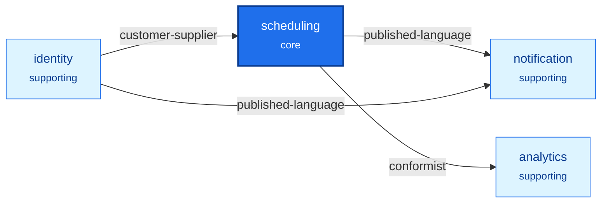

[English](context-map.md) · **Français**
<!-- translation-of: context-map.md sha256:edb23881d37d4b0d -->

# Carte des contextes

Le diagramme et le tableau sont générés par `npx ddd-ts-kit docs` à partir de
`ddd-ts-kit.config.json` et des fichiers `CONTEXT.md`. Tout ce qui est hors des marqueurs est écrit
par l'équipe et conservé.

<!-- ddd-ts-kit:context-map -->

| Context | Classification | Purpose | Upstreams | Downstreams | Published events | Deployable alone |
|---|---|---|---|---|---|---|
| `analytics` | supporting | Measures the occupancy, the cancellations and the no-shows of each calendar, per day. | `scheduling` |  |  | no |
| `identity` | supporting | Knows the people, the practices they work in and what a practitioner delegated to an assistant. |  | `scheduling`, `notification` | `identity.delegation.granted`, `identity.delegation.revoked`, `identity.person.registered`, `identity.practice.member-added`, `identity.practice.member-removed`, `identity.practice.opened` | no |
| `notification` | supporting | Tells people what happened to their appointments and reminds them before the start. | `scheduling`, `identity` |  |  | no |
| `scheduling` | core | Publishes the availability of calendars and takes appointments on them, from booking to completion. | `identity` | `notification`, `analytics` | `scheduling.appointment.booked`, `scheduling.appointment.cancelled`, `scheduling.appointment.completed`, `scheduling.appointment.confirmed`, `scheduling.appointment.expired`, `scheduling.appointment.marked-no-show`, `scheduling.appointment.rescheduled`, `scheduling.calendar.created` | no |
<!-- /ddd-ts-kit:context-map -->

## Guide de lecture

Un responsable ajoute un praticien dans `identity` ; `scheduling` l'apprend par un événement et
laisse ce praticien ouvrir un calendrier. Un patient réserve dans `scheduling`, qui occupe le
créneau et l'annonce ; `notification` prévient le patient et planifie le rappel, `analytics` le
compte. Rien ne remonte vers `scheduling`, et rien d'autre que le journal d'audit de la plateforme
ne voit tous les contextes.

## Pourquoi ces frontières

- `identity` / `scheduling` : « praticien » est un membre avec un rôle dans `identity` et le
  propriétaire de calendriers dans `scheduling` ; les adhésions et les délégations changent sans
  qu'un calendrier s'en aperçoive.
- `scheduling` garde ensemble les disponibilités, les rendez-vous et la liste d'attente : qu'un
  créneau soit libre doit être vrai au même instant que les rendez-vous qui occupent le calendrier.
  Deux contextes demanderaient une vérification distribuée pour la seule garantie que vend le
  produit.
- `notification` à part : un fournisseur de courriel en panne ne doit jamais refuser une
  réservation.
- `analytics` à part : il parle en décomptes par jour, ne décide rien et peut avoir du retard.
- Les délégations restent dans `identity` et ne sont pas copiées par `scheduling` : `identity` écrit
  la relation sur le poste du praticien, `scheduling` relie chaque calendrier à son poste, et le
  modèle d'autorisation les joint. Les événements `identity.delegation.*` existent pour le journal
  d'audit.
- Le journal d'audit est une capacité de la plateforme (`src/platform/audit/`), pas un contexte : il
  enregistre autour de chaque cas d'usage de chaque contexte, n'a pas de langage et ne prend aucune
  décision propre. Il devient un contexte le jour où les auditeurs ont des cas d'usage
  (conservations légales, exports avec un circuit de validation).

## Notes sur les relations

- `scheduling` depuis `identity`, client-fournisseur : le cœur dit ce dont il a besoin (le fuseau
  horaire du cabinet dans l'événement d'adhésion, une recherche groupée des noms affichés) et
  `identity` le planifie. Coût : un changement de ces contrats se négocie d'abord avec `scheduling`.
- `analytics` depuis `scheduling`, conformiste : `analytics` mesure les faits de `scheduling` dans
  les termes de `scheduling`. Coût : il bouge chaque fois que ces événements bougent, et n'a pas voix
  au chapitre.
- Deux façons de lire `identity` depuis `scheduling`, une de chaque, à dessein. Une projection
  (`practitioners`, alimentée par `identity.practice.member-added` et `.member-removed`) : la donnée
  décide (un calendrier n'est créé que pour un praticien du cabinet) et libelle chaque ligne d'un
  agenda, elle doit donc être là quand `identity` ne l'est pas. Une *gateway* avec hydratation
  (`PersonDirectory`, le nom affiché du patient sur le détail d'un rendez-vous) : un élément, lu
  rarement, toujours à jour, et les données personnelles restent là où elles sont possédées.

## Tensions connues

- `scheduling` est gros (calendriers, rendez-vous, liste d'attente). Signal d'un découpage : des
  disponibilités vendues seules, ou une liste d'attente qui se dote de règles qui ne lisent jamais
  un calendrier.
- `notification` détient les rappels. Signal : des rappels qui se dotent de leurs propres canaux,
  préférences et heures de silence.
- Une organisation au-dessus des cabinets n'est pas modélisée. Signal : un responsable pour
  plusieurs cabinets.
