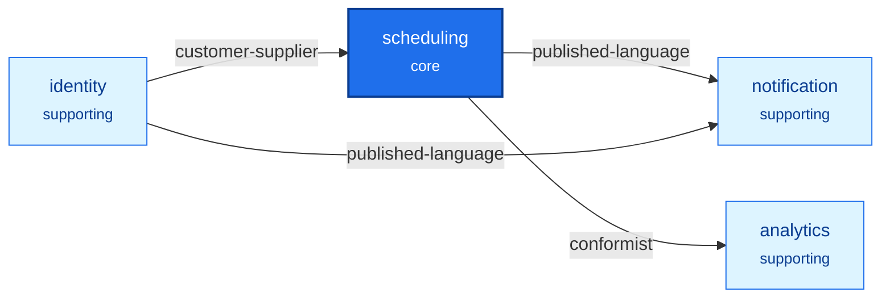

**English** · [Français](context-map.fr.md)

# Context map

The diagram and the table are generated by `npx ddd-ts-kit docs` from `ddd-ts-kit.config.json`
and the `CONTEXT.md` files. Everything outside the markers is written by the team and kept.

<!-- ddd-ts-kit:context-map -->

| Context | Classification | Purpose | Upstreams | Downstreams | Published events | Deployable alone |
|---|---|---|---|---|---|---|
| `analytics` | supporting | Measures the occupancy, the cancellations and the no-shows of each calendar, per day. | `scheduling` |  |  | no |
| `identity` | supporting | Knows the people, the practices they work in and what a practitioner delegated to an assistant. |  | `scheduling`, `notification` | `identity.delegation.granted`, `identity.delegation.revoked`, `identity.person.registered`, `identity.practice.member-added`, `identity.practice.member-removed`, `identity.practice.opened` | no |
| `notification` | supporting | Tells people what happened to their appointments and reminds them before the start. | `scheduling`, `identity` |  |  | no |
| `scheduling` | core | Publishes the availability of calendars and takes appointments on them, from booking to completion. | `identity` | `notification`, `analytics` | `scheduling.appointment.booked`, `scheduling.appointment.cancelled`, `scheduling.appointment.completed`, `scheduling.appointment.confirmed`, `scheduling.appointment.expired`, `scheduling.appointment.marked-no-show`, `scheduling.appointment.rescheduled`, `scheduling.calendar.created` | no |
<!-- /ddd-ts-kit:context-map -->

## Reading guide

A manager adds a practitioner in `identity`; `scheduling` learns it from an event and lets that
practitioner open a calendar. A patient books in `scheduling`, which holds the slot and announces
it; `notification` tells the patient and plans the reminder, `analytics` counts it. Nothing flows
back to `scheduling`, and nothing but the audit trail of the platform sees every context.

## Why these boundaries

- `identity` / `scheduling`: "practitioner" is a member with a role in `identity` and the owner of
  calendars in `scheduling`; memberships and delegations change without a calendar noticing.
- `scheduling` keeps availability, appointments and the waitlist together: whether a slot is free
  must be true at the same instant as the appointments that hold the calendar. Two contexts would
  need a distributed check for the one guarantee the product sells.
- `notification` apart: a mail provider being down must never refuse a booking.
- `analytics` apart: it speaks in counts per day, decides nothing and may lag.
- Delegations stay in `identity` and are not copied by `scheduling`: `identity` writes the
  relationship on the practitioner's desk, `scheduling` relates each calendar to its desk, and the
  authorization model joins them. The events `identity.delegation.*` exist for the audit trail.
- The audit trail is a capability of the platform (`src/platform/audit/`), not a context: it
  records around every use case of every context, has no language and takes no decision of its
  own. It becomes a context the day auditors get use cases (legal holds, exports with a workflow).

## Relationship notes

- `scheduling` from `identity`, customer-supplier: the core states what it needs (the time zone
  of the practice inside the membership event, a batch lookup of display names) and `identity`
  plans it. Cost: a change of those contracts is negotiated with `scheduling` first.
- `analytics` from `scheduling`, conformist: `analytics` measures the facts of `scheduling` in
  the terms of `scheduling`. Cost: it moves whenever those events move, and has no say.
- Two ways to read `identity` from `scheduling`, one of each on purpose. A projection
  (`practitioners`, fed by `identity.practice.member-added` and `.member-removed`): the data
  decides (a calendar is created only for a practitioner of the practice) and labels every row of
  an agenda, so it must be there when `identity` is not. A gateway with hydration
  (`PersonDirectory`, the display name of the patient on the detail of one appointment): one
  element, read rarely, always current, and personal data stays where it is owned.

## Known tensions

- `scheduling` is large (calendars, appointments, waitlist). Signal for a split: availability
  sold on its own, or the waitlist growing rules that never read a calendar.
- `notification` holds reminders. Signal: reminders getting channels, preferences and quiet hours
  of their own.
- An organization above practices is not modelled. Signal: one manager for several practices.
