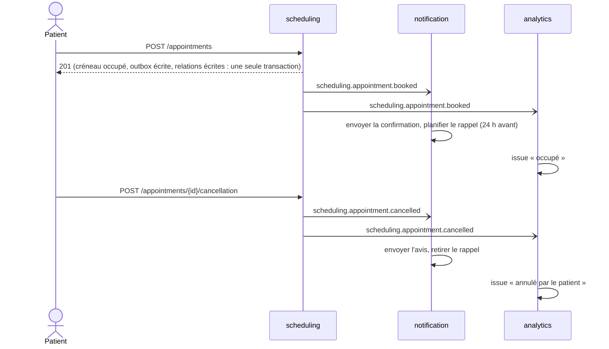
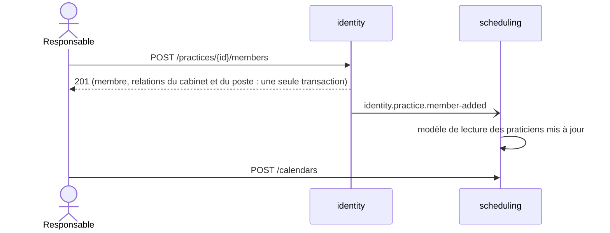

[English](README.md) · **Français**
<!-- translation-of: README.md sha256:8b234a35b7649b5b -->

# Intégration

`event-catalog.md` et `asyncapi.yaml`, dans ce dossier, sont générés par `npm run docs:generate` à
partir des déclarations d'événements ; le contrat sous `openapi/`, à partir des définitions de
routes. Ce fichier est écrit par l'équipe et répond à ce que les fichiers générés ne peuvent pas
dire.

## Garanties de livraison

Au moins une fois, jamais exactement une fois : un événement peut être livré deux fois, et en
retard. Chaque consommateur est inscrit sous un nom stable et marque l'événement comme traité dans
la transaction de son propre travail, si bien qu'une seconde livraison ne change rien. Il n'y a pas
d'ordre entre rendez-vous, et aucun n'est promis à l'intérieur d'un même rendez-vous non plus :
chaque événement de `scheduling.appointment.*` porte l'état qu'il établit (le créneau, le jour, la
partie), et les modèles de lecture d'`analytics` et de `scheduling` gardent l'estampille du dernier
événement appliqué à une ligne, si bien qu'un événement en retard est écarté comme périmé au lieu
de la faire revenir en arrière. Un consommateur doit tolérer : un doublon, un événement sur un
élément qu'il n'a jamais vu (une annulation avant la réservation : ignorée), des champs inconnus.

## Fournisseur

Redis Streams (Redis, Dragonfly ou Valkey) : les gestionnaires écrivent dans l'outbox transactionnelle, le relais ajoute chaque événement au flux de son type et marque l'enregistrement comme publié une fois que le serveur a répondu à son entrée, chaque contexte consommateur lit par un groupe de consommateurs à son propre nom, acquitte après la validation (commit) de son unité de travail, est relivré un nombre borné de fois après un délai, puis déplace l'événement vers un flux de rejet. La durabilité est celle pour laquelle le serveur est configuré, la rétention est bornée par sa mémoire, et il n'y a pas d'ordre par agrégat : portez une version dans le contenu quand cela compte.

| Environnement | Fournisseur | Pourquoi |
|---|---|---|
| *specs* unitaires et de gestionnaires | bus en mémoire de l'application de test | aucune entrée-sortie |
| *specs* de bout en bout | le fournisseur en processus, ou Redis Streams quand `REDIS_URL` est défini | les mêmes gestionnaires dans les deux cas |
| exécution locale, déployé | Redis Streams sur Dragonfly (`REDIS_URL`), le serveur qui détient déjà le cache, le verrou des *jobs* et le limiteur de débit | un seul serveur à maintenir en vie au lieu de deux ; limites acceptées : rétention bornée par la mémoire, pas d'ordre par clé |

Un consommateur en échec est relivré un nombre borné de fois, puis son événement part dans le flux
de rejet de son consommateur et est signalé une fois au système de remontée des erreurs avec
l'identifiant de trace de la requête HTTP qui l'a publié. Rejouer un événement rejeté, c'est
l'ajouter de nouveau à son flux ; la marque d'événement traité rend cela sûr. Un modèle de lecture
qui a dérivé n'est pas rejoué mais reconstruit à partir de sa source (`analytics` :
`ProjectionRebuild` sur l'export des rendez-vous de `scheduling`).

## Politique de versionnement

À l'intérieur d'une version, on ajoute un champ, facultatif, et rien d'autre. Une suppression, un
renommage ou un changement de sens est une nouvelle version
(`generate integration-event ... --version 2`), publiée à côté de l'ancienne. L'ancienne version reste jusqu'à ce que
`docs/integration/event-catalog.md` ne lui liste plus aucun consommateur, et son retrait est
annoncé dans le *changelog* une version (release) à l'avance.

## Flux

Un patient réserve, puis annule. Le patient lit son rendez-vous tout de suite (il est dans la
transaction de la commande) ; le courriel, le rappel et les chiffres suivent dans l'intervalle du
relais (une demi-seconde en local) plus le travail du consommateur. `analytics` stocke l'issue de
chaque rendez-vous et rien d'autre : l'occupation est mesurée à partir des issues au moment où on
la lit.

Un responsable ajoute un praticien, qui peut ensuite ouvrir un calendrier. Entre les deux appels,
il y a une fenêtre : tant que `scheduling` n'a pas appliqué l'événement, la création du calendrier
répond `UNKNOWN_PRACTITIONER`.

## Intégrations externes

| Système | Port | Adaptateur | Comportement en cas d'échec | Configuré par |
|---|---|---|---|---|
| Fournisseur de courriel | `Mailer` (`notification`) | l'adaptateur de développement écrit dans le journal ; sa nouvelle tentative et son délai d'expiration sont déclarés sur la classe de l'adaptateur | nouvelles tentatives, puis l'événement consommé part en file de rejet et est signalé ; le rendez-vous n'est pas touché | rien pour l'instant (aucun identifiant de fournisseur en développement) |
| Keycloak | `Authenticator` (plateforme) | `keycloakAuthenticator`, jeu de clés récupéré et mis en cache | un jeu de clés impossible à récupérer est une 5xx, jamais un refus | `KEYCLOAK_URL`, `KEYCLOAK_REALM`, `KEYCLOAK_AUDIENCE` |
| `identity`, depuis `scheduling` | `PersonDirectoryGateway` | en processus aujourd'hui, un client distant le jour où `identity` est extrait | la vue de détail se replie sur « inconnu » et le dit dans `warnings` | aucun |
| `scheduling`, depuis `analytics` | `AppointmentExportGateway` | en processus aujourd'hui | une reconstruction qui échoue laisse le modèle de lecture tel qu'il était | aucun |
| Système de suivi des erreurs | `ErrorReporter` (plateforme) | `@ddd-ts-kit/sentry` | les signalements sont perdus, les échecs sont toujours journalisés | `SENTRY_DSN` |
| Système de traces | aucun (instrumentation) | OTLP sur HTTP | les *spans* sont perdus | `OTEL_EXPORTER_OTLP_ENDPOINT` |
