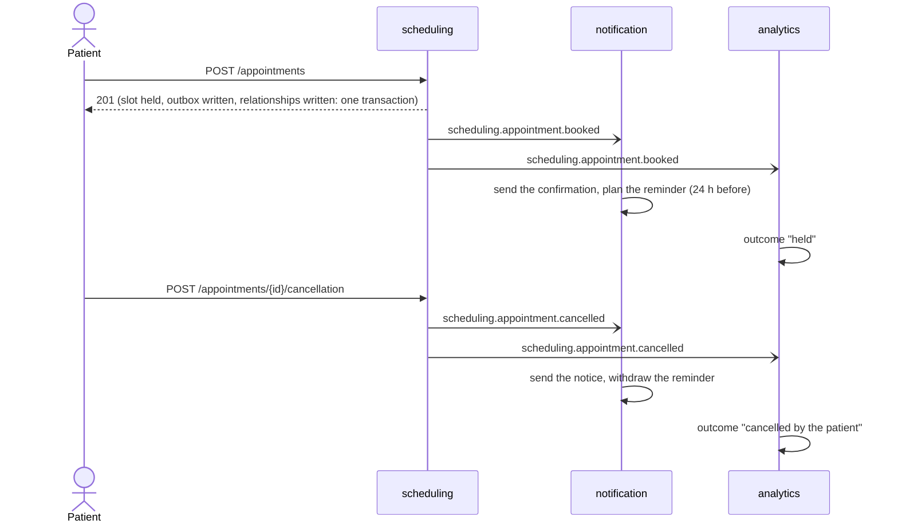
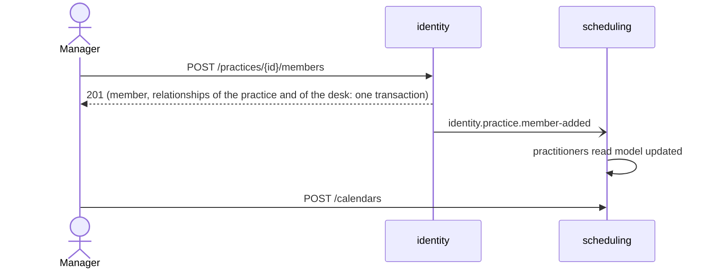

# Integration

`event-catalog.md` and `asyncapi.yaml` in this folder are generated by `npm run docs:generate`
from the event declarations; the contract under `openapi/` from the route definitions. This file is
written by the team and answers what the generated files cannot.

## Delivery guarantees

At least once, never exactly once: an event may be delivered twice, and late. Every consumer is
registered under a stable name and marks the event as processed in the transaction of its own
work, so a second delivery changes nothing. There is no order across appointments, and none is
promised inside one appointment either: every event of `scheduling.appointment.*` carries the
state it sets (the slot, the day, the party), and the read models of `analytics` and of
`scheduling` keep the stamp of the last event applied to a row, so a late event is dropped as
stale instead of rewinding it. A consumer must tolerate: a duplicate, an event for an element it
never saw (a cancellation before the booking: ignored), unknown fields.

## Provider

Redis Streams (Redis, Dragonfly or Valkey): handlers write to the transactional outbox, the relay appends each event to the stream of its type and marks the record published once the server answered its entry, each consuming context reads through a consumer group of its own name, acknowledges after its unit of work committed, is redelivered a bounded number of times after a delay and then moves the event to a dead stream. Durability is what the server is configured for, retention is bounded by its memory, and there is no order per aggregate: carry a version in the payload when it matters.

| Environment | Provider | Why |
|---|---|---|
| unit and handler specs | in-memory bus of the test application | no I/O |
| end-to-end specs | the in-process provider, or Redis Streams when `REDIS_URL` is set | the same handlers either way |
| local run, deployed | Redis Streams on Dragonfly (`REDIS_URL`), the server that already holds the cache, the job lock and the rate limiter | one server to keep alive instead of two; accepted limits: retention bounded by memory, no order per key |

A failing consumer is redelivered a bounded number of times, then its event goes to the dead
stream of its consumer and is reported once to the error reporter with the trace id of the
request that published it. Replaying a dead event is appending it again to its stream; the
processed-event mark makes it safe. A read model that drifted is not replayed but rebuilt from its
source (`analytics`: `ProjectionRebuild` over the appointment export of `scheduling`).

## Versioning policy

Inside a version a field is added, optional, and nothing else. A removal, a rename or a change
of meaning is a new version (`generate integration-event ... --version 2`), published next to
the old one. The old version stays until `docs/integration/event-catalog.md` lists no consumer
for it, and its retirement is announced in the changelog one release ahead.

## Flows

A patient books, then cancels. The patient reads their appointment at once (it is in the
transaction of the command); the mail, the reminder and the figures follow within the relay
interval (half a second locally) plus the consumer's work. `analytics` stores the outcome of each
appointment and nothing else: the occupancy is measured from the outcomes when it is read.

A manager adds a practitioner, who can then open a calendar. Between the two calls there is a
window: until `scheduling` applied the event, creating the calendar answers `UNKNOWN_PRACTITIONER`.

## External integrations

| System | Port | Adapter | Failure behaviour | Configured by |
|---|---|---|---|---|
| Mail provider | `Mailer` (`notification`) | the development adapter writes to the log; its retry and its time limit are declared on the adapter class | retried, then the consumed event is dead-lettered and reported; the appointment is untouched | nothing yet (no provider credentials in development) |
| Keycloak | `Authenticator` (platform) | `keycloakAuthenticator`, key set fetched and cached | a key set that cannot be fetched is a 5xx, never a refusal | `KEYCLOAK_URL`, `KEYCLOAK_REALM`, `KEYCLOAK_AUDIENCE` |
| `identity`, from `scheduling` | `PersonDirectoryGateway` | in process today, a remote client the day `identity` is extracted | the detail view falls back to "unknown" and says so in `warnings` | none |
| `scheduling`, from `analytics` | `AppointmentExportGateway` | in process today | a rebuild that fails leaves the read model as it was | none |
| Error tracker | `ErrorReporter` (platform) | `@ddd-ts-kit/sentry` | reports are dropped, failures are still logged | `SENTRY_DSN` |
| Trace backend | none (instrumentation) | OTLP over HTTP | spans are dropped | `OTEL_EXPORTER_OTLP_ENDPOINT` |
