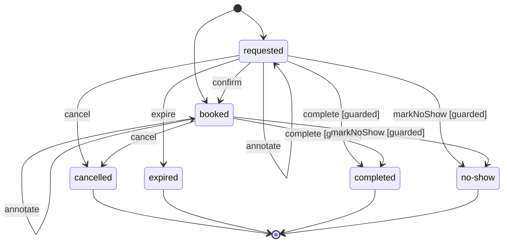

# Scheduling

## Purpose

Publishes the availability of calendars and takes appointments on them, from booking to completion. It guarantees that a time on a calendar is held once.

## Classification

core

This is why practices come: a time on a calendar is held once, under rules of availability no off-the-shelf tool gives them. It gets the richest model and the most tests.

## Ubiquitous language

| Term | Meaning | Not to be confused with |
|---|---|---|
| Calendar | The agenda a practitioner opens to booking in a practice, with its availability and its booking rules | analytics: a line that is measured |
| Create | To open a new calendar for a practitioner, or the attendance record of a patient at its first fact |  |
| Practitioner | The owner of calendars, known from identity | identity: a member with a role |
| Patient | The person an appointment is for | identity: Person |
| Availability | When a calendar can be booked: opening hours, exceptions and time off together |  |
| Opening hours | The weekly ranges, in the wall-clock time of the practice, during which a calendar takes appointments |  |
| Range | A span of one day between two wall-clock times | Slot, which is a span between two instants |
| Exception | A day whose hours replace the weekly ones: closed, or opened on other ranges | Time off |
| Time off | A period during which nothing can be booked, whatever the hours | Exception |
| Appointment type | A kind of appointment a calendar offers, with its duration, its grid, its buffer and whether it needs a confirmation |  |
| Duration | How long an appointment of a type lasts |  |
| Grid | The step, in minutes from midnight, on which appointments of a type start |  |
| Buffer | The time kept free after an appointment, part of what it holds |  |
| Booking window | The earliest and the latest a slot can be booked: a minimum notice and a maximum horizon |  |
| Notice | The minimum time between booking and start | notification: a message |
| Horizon | The maximum time between booking and start |  |
| Limit | The number of future appointments a patient may hold with one practitioner |  |
| Slot | A span of time on a calendar that an appointment holds or could hold | Range |
| Scheduler | The rule keeper that says whether a slot can be taken on a calendar, given what the calendar already holds |  |
| Appointment | The hold of a slot on a calendar for a patient, from booking to its end |  |
| Lifecycle | The statuses an appointment goes through, and which change leads from one to the next |  |
| Deadline | The instant before which a requested appointment is confirmed, or expires | Horizon |
| Book | To take a free slot for a patient | Request |
| Request | To take a slot that the patient must still confirm |  |
| Confirm | To say that a requested appointment will be honoured |  |
| Reschedule | To move an appointment to another slot of the same calendar, in one step |  |
| Cancel | To end an appointment before it takes place, saying who and why | Expire |
| Cancellation | Who cancelled (the patient or the practice) and the reason given | analytics: a count |
| Reason | The words given for a cancellation |  |
| Expire | To end a requested appointment that was not confirmed in time | Cancel |
| Complete | To say that an appointment took place |  |
| No show | The patient did not come |  |
| Mark | To record a no-show after the start |  |
| Waitlist | The people waiting for a freed slot on one calendar and one day, in arrival order |  |
| Waiter | A patient on a waitlist, for an appointment type |  |
| Join | To enter a waitlist |  |
| Leave | To quit a waitlist |  |
| Offer | A freed slot held for one waiter until a deadline |  |
| Hold | The time during which an offer waits for its waiter |  |
| Agenda | The appointments of a calendar or of a practice over a day, as the people who run it see them |  |
| Day | A calendar date in the time zone of the practice |  |
| Time zone | The zone whose wall clock the practice lives by |  |
| Free | Not held by any appointment, time off or closed hour |  |
| Busy | Held, without saying by whom |  |
| Unconfirmed | Requested and not confirmed yet |  |
| Booking | What an appointment holds: a slot and its day on a calendar of a practice, for a patient and an appointment type |  |
| Set | To give a calendar its weekly opening hours, replacing the previous ones |  |
| Add | To put an exception or a time off on a calendar |  |
| Define | To describe an appointment type a calendar offers |  |
| Freed | Free again after an appointment ended or moved |  |
| Search | To read the appointments one may see, narrowed, sorted and page by page |  |
| Practice | The place practitioners receive patients in, known from identity by its identifier; it lives in one time zone |  |
| Read | To see an appointment, or the agenda of a practice, as one is allowed to |  |
| Get | To read one element one may see |  |
| Browse | To look at the day of a calendar as anyone signed in may see it |  |
| Annotate | To write an internal note on an appointment, for the staff of its practice |  |
| Internal note | What the staff of a practice writes about an appointment for themselves: its practitioner writes it, its assistants read it, its patient never sees it | Reason, which the canceller gives |
| Export | To hand over every appointment of an agenda at once, read as it is written |  |
| Attendance | Whether a patient came to the appointments they held with a practice |  |
| Record | What a practice keeps of the attendance of one patient: the no-shows and cancellations noted, in order |  |
| Note | To keep a fact in an attendance record, once per appointment |  |
| History | The facts of an attendance record as they were noted, oldest first |  |
| Document | A file attached to an appointment by the practice: a referral, a prescription, a report; its content lives in the file storage |  |
| Attached | Joined to an appointment, kept as a reference to the stored file |  |
| Remove | To take a document off an appointment, its file deleted once the change is committed |  |
| Name | What a document was called when it was sent, shown back to people |  |
| Clear | To cancel, through a worker, every appointment a calendar holds over a period, before an absence of its practitioner |  |
| Clearance | One clearing of a calendar, followed while a worker cancels its appointments one by one |  |

## Aggregates

<!-- ddd-ts-kit:aggregates -->
- `Appointment`
- `AttendanceRecord` (event-sourced)
- `Calendar`
- `Waitlist`
<!-- /ddd-ts-kit:aggregates -->

## Published events

<!-- ddd-ts-kit:events -->
- `scheduling.appointment.booked` (version 1)
- `scheduling.appointment.cancelled` (version 1)
- `scheduling.appointment.completed` (version 1)
- `scheduling.appointment.confirmed` (version 1)
- `scheduling.appointment.expired` (version 1)
- `scheduling.appointment.marked-no-show` (version 1)
- `scheduling.appointment.rescheduled` (version 1)
- `scheduling.calendar.created` (version 1)
<!-- /ddd-ts-kit:events -->

## Permissions

<!-- ddd-ts-kit:permissions -->
- `scheduling:appointment.cancel`
- `scheduling:appointment.reschedule`
- `scheduling:appointment.expire`
- `scheduling:calendar.create`
- `scheduling:appointment.book`
- `scheduling:appointment.confirm`
- `scheduling:appointment.complete`
- `scheduling:appointment.mark-no-show`
- `scheduling:calendar.set-opening-hours`
- `scheduling:calendar.add-exception`
- `scheduling:calendar.add-time-off`
- `scheduling:calendar.define-appointment-type`
- `scheduling:waitlist.join`
- `scheduling:waitlist.offer`
- `scheduling:appointment.search`
- `scheduling:agenda.read`
- `scheduling:appointment.read`
- `scheduling:calendar.browse`
- `scheduling:appointment.attach-document`
- `scheduling:appointment.remove-document`
- `scheduling:appointment.read-document`
- `scheduling:appointment.note.read`
- `scheduling:appointment.note.write`
- `scheduling:attendance.note`
- `scheduling:attendance.read`
- `scheduling:calendar.clear`
<!-- /ddd-ts-kit:permissions -->

## Scheduled jobs

<!-- ddd-ts-kit:jobs -->
| Job | Schedule | Command |
|---|---|---|
| `scheduling.expire-unconfirmed-appointments` | `every 5m` | `ExpireUnconfirmedAppointments` |
<!-- /ddd-ts-kit:jobs -->

## Background jobs

<!-- ddd-ts-kit:background-jobs -->
| Job | Class |
|---|---|
| `scheduling.clear-calendar` | `ClearCalendarBackgroundJob` |
| `scheduling.confirmation-deadline-timeout` | `ConfirmationDeadlineTimeoutBackgroundJob` |
<!-- /ddd-ts-kit:background-jobs -->

## State machines

<!-- ddd-ts-kit:state-machines -->
Lifecycle of `appointment` (`domain/state-machines/appointment.state-machine.ts`):

<!-- /ddd-ts-kit:state-machines -->

## Process managers

<!-- ddd-ts-kit:processes -->
| Process | Class | Timeouts delivered by |
|---|---|---|
| `scheduling.confirmation-deadline` | `ConfirmationDeadlineProcess` | `scheduling.confirmation-deadline-timeout` |
<!-- /ddd-ts-kit:processes -->

The confirmation deadline of a requested appointment is a process: armed when the appointment
is requested, disarmed when it is confirmed, cancelled or expired, and when the deadline passes
first it expires the appointment at that instant. `ExpireUnconfirmedAppointmentsJob` stays the
safety net: every five minutes, it expires what a lost timeout left.

## Relationships

<!-- ddd-ts-kit:relationships -->
- Downstream of `identity` (customer-supplier).
- Upstream of `notification` (published-language).
- Upstream of `analytics` (conformist).
<!-- /ddd-ts-kit:relationships -->

## Domain events and what follows them

An effect of a domain event exists only if the state change that recorded it is committed. Every
handler of this context runs at the end of the unit of work of the command, before its commit,
and has transactional effects only: the publishers append to the outbox, the projections write
their tables, three handlers send `OfferFreedSlotCommand`, which joins the unit of work, and
`CalendarCreatedEventHandler` and `AppointmentBookedEventHandler` write the relationships of a
calendar and of an appointment through `SchedulingRelationships`. Its adapter,
`TupleSchedulingRelationships`, writes tuples in a table of the same database (ADR-0001): it is
a persistence adapter, in `infrastructure/persistence/`, for the reasons given in the
`CONTEXT.md` of `identity`.

## Reference

<!-- ddd-ts-kit:reference -->
Generated from the code by `ddd-ts-kit docs`; the same facts as data: `ddd-ts-kit describe scheduling --json`. The fields of each schema are in the generated contracts: [OpenAPI](../../../openapi/openapi.yaml), [event catalog](../../../docs/integration/event-catalog.md).

**Dependencies**: upstreams: `identity` (customer-supplier); downstreams: `notification` (published-language), `analytics` (conformist).

### Use cases

| Use case | Kind | Permission |
|---|---|---|
| `AddException` | command | `calendar.add-exception` |
| `AddTimeOff` | command | `calendar.add-time-off` |
| `AttachAppointmentDocument` | command | `appointment.attach-document` |
| `BookAppointment` | command | `appointment.book` |
| `CancelAppointment` | command | `appointment.cancel` |
| `ClearCalendar` | command | `calendar.clear` |
| `CompleteAppointment` | command | `appointment.complete` |
| `ConfirmAppointment` | command | `appointment.confirm` |
| `CreateCalendar` | command | `calendar.create` |
| `DefineAppointmentType` | command | `calendar.define-appointment-type` |
| `ExpireUnconfirmedAppointments` | command | `appointment.expire` |
| `GetAppointment` | query | `appointment.read` |
| `GetAppointmentDocument` | query | `appointment.read-document` |
| `GetCalendarDay` | query | `calendar.browse` |
| `GetClearance` | query | `calendar.clear` |
| `GetOpeningHours` | query | `public` |
| `JoinWaitlist` | command | `waitlist.join` |
| `MarkAppointmentNoShow` | command | `appointment.mark-no-show` |
| `NoteCancellation` | command | `attendance.note` |
| `NoteNoShow` | command | `attendance.note` |
| `OfferFreedSlot` | command | `waitlist.offer` |
| `RemoveAppointmentDocument` | command | `appointment.remove-document` |
| `RescheduleAppointment` | command | `appointment.reschedule` |
| `SearchAppointments` | query | `appointment.search` |
| `SearchAttendanceHistory` | query | `attendance.read` |
| `SearchPracticeAgenda` | query | `agenda.read` |
| `SetOpeningHours` | command | `calendar.set-opening-hours` |

### Routes

| Method | Path | Operation | Group | Guards | Use case | Permission | Request | Responses | Errors |
|---|---|---|---|---|---|---|---|---|---|
| GET | `/appointments` | `searchAppointments` | `AppointmentsRoutes` | `Authenticated` | `SearchAppointments` | `appointment.search` | query | 200: `page of AgendaLine` | `UNAUTHORIZED`, `FORBIDDEN`, `INVALID_CRITERIA` |
| POST | `/appointments` | `bookAppointment` | `AppointmentsRoutes` | `Authenticated` | `BookAppointment` | `appointment.book` | body | 201: `acceptedSchema` | `UNAUTHORIZED`, `FORBIDDEN`, `UNKNOWN_CALENDAR`, `UNKNOWN_APPOINTMENT_TYPE`, `OUTSIDE_AVAILABILITY`, `OFF_GRID`, `BOOKING_TOO_LATE`, `BOOKING_TOO_FAR`, `SLOT_TAKEN`, `PATIENT_LIMIT_REACHED` |
| GET | `/appointments/:appointmentId` | `getAppointment` | `AppointmentsRoutes` | `Authenticated` | `GetAppointment` | `appointment.read` | params: `GetAppointmentParams` | 200: `answer` | `UNAUTHORIZED`, `FORBIDDEN`, `APPOINTMENT_NOT_FOUND` |
| POST | `/appointments/:appointmentId/cancellation` | `cancelAppointment` | `AppointmentsRoutes` | `Authenticated` | `CancelAppointment` | `appointment.cancel` | params: `CancelAppointmentParams`, body: `CancelAppointmentBody` | 201: `acceptedSchema` | `UNAUTHORIZED`, `FORBIDDEN`, `APPOINTMENT_NOT_FOUND`, `APPOINTMENT_ENDED`, `REASON_REQUIRED` |
| POST | `/appointments/:appointmentId/completion` | `completeAppointment` | `AppointmentsRoutes` | `Authenticated` | `CompleteAppointment` | `appointment.complete` | params: `CompleteAppointmentParams` | 201: `acceptedSchema` | `UNAUTHORIZED`, `FORBIDDEN`, `APPOINTMENT_NOT_FOUND`, `APPOINTMENT_ENDED`, `APPOINTMENT_NOT_STARTED` |
| POST | `/appointments/:appointmentId/confirmation` | `confirmAppointment` | `AppointmentsRoutes` | `Authenticated` | `ConfirmAppointment` | `appointment.confirm` | params: `ConfirmAppointmentParams` | 201: `acceptedSchema` | `UNAUTHORIZED`, `FORBIDDEN`, `APPOINTMENT_NOT_FOUND`, `APPOINTMENT_ENDED`, `APPOINTMENT_ALREADY_CONFIRMED` |
| DELETE | `/appointments/:appointmentId/document` | `removeAppointmentDocument` | `AppointmentsRoutes` | `Authenticated` | `RemoveAppointmentDocument` | `appointment.remove-document` | params: `RemoveAppointmentDocumentParams` | 200: `acceptedSchema` | `UNAUTHORIZED`, `FORBIDDEN`, `APPOINTMENT_NOT_FOUND`, `NO_DOCUMENT` |
| GET | `/appointments/:appointmentId/document` | `getAppointmentDocument` | `AppointmentsRoutes` | `Authenticated` | `GetAppointmentDocument` | `appointment.read-document` | params: `GetAppointmentDocumentParams` | 200: `GetAppointmentDocumentAnswer` | `UNAUTHORIZED`, `FORBIDDEN`, `APPOINTMENT_NOT_FOUND`, `NO_DOCUMENT` |
| POST | `/appointments/:appointmentId/document` | `attachAppointmentDocument` | `AppointmentsRoutes` | `Authenticated` | `AttachAppointmentDocument` | `appointment.attach-document` | params: `AttachAppointmentDocumentParams` | 201: `acceptedSchema` | `UNAUTHORIZED`, `FORBIDDEN`, `APPOINTMENT_NOT_FOUND`, `DOCUMENT_NAME_TOO_LONG`, `FILE_REJECTED` |
| POST | `/appointments/:appointmentId/no-show` | `markAppointmentNoShow` | `AppointmentsRoutes` | `Authenticated` | `MarkAppointmentNoShow` | `appointment.mark-no-show` | params: `MarkAppointmentNoShowParams` | 201: `acceptedSchema` | `UNAUTHORIZED`, `FORBIDDEN`, `APPOINTMENT_NOT_FOUND`, `APPOINTMENT_ENDED`, `APPOINTMENT_NOT_STARTED` |
| POST | `/appointments/:appointmentId/reschedule` | `rescheduleAppointment` | `AppointmentsRoutes` | `Authenticated` | `RescheduleAppointment` | `appointment.reschedule` | params: `RescheduleAppointmentParams`, body: `RescheduleAppointmentBody` | 201: `acceptedSchema` | `UNAUTHORIZED`, `FORBIDDEN`, `APPOINTMENT_NOT_FOUND`, `APPOINTMENT_ENDED`, `UNKNOWN_CALENDAR`, `UNKNOWN_APPOINTMENT_TYPE`, `OUTSIDE_AVAILABILITY`, `OFF_GRID`, `BOOKING_TOO_LATE`, `BOOKING_TOO_FAR`, `SLOT_TAKEN`, `PATIENT_LIMIT_REACHED` |
| POST | `/calendars` | `createCalendar` | `CalendarsRoutes` | `Authenticated` | `CreateCalendar` | `calendar.create` | body: `CreateCalendarBody` | 201: `acceptedSchema` | `UNAUTHORIZED`, `FORBIDDEN`, `UNKNOWN_PRACTITIONER`, `UNKNOWN_TIME_ZONE` |
| POST | `/calendars/:calendarId/appointment-types` | `defineAppointmentType` | `CalendarsRoutes` | `Authenticated` | `DefineAppointmentType` | `calendar.define-appointment-type` | params: `DefineAppointmentTypeParams`, body: `DefineAppointmentTypeBody` | 201: `acceptedSchema` | `UNAUTHORIZED`, `FORBIDDEN`, `UNKNOWN_CALENDAR`, `INVALID_APPOINTMENT_TYPE` |
| POST | `/calendars/:calendarId/clearances` | `clearCalendar` | `CalendarsRoutes` | `Authenticated` | `ClearCalendar` | `calendar.clear` | params: `ClearCalendarParams`, body: `ClearCalendarBody` | 202: `ClearCalendarAccepted` | `UNAUTHORIZED`, `FORBIDDEN`, `UNKNOWN_CALENDAR`, `INVALID_TIME_OFF` |
| GET | `/calendars/:calendarId/clearances/:clearanceId` | `getClearance` | `CalendarsRoutes` | `Authenticated` | `GetClearance` | `calendar.clear` | params: `GetClearanceParams` | 200: `GetClearanceAnswer` | `UNAUTHORIZED`, `FORBIDDEN`, `UNKNOWN_CLEARANCE` |
| GET | `/calendars/:calendarId/days/:day` | `getCalendarDay` | `CalendarsRoutes` | `Authenticated` | `GetCalendarDay` | `calendar.browse` | params: `GetCalendarDayParams` | 200: `GetCalendarDayAnswer` | `UNAUTHORIZED`, `FORBIDDEN`, `UNKNOWN_CALENDAR`, `INVALID_DAY` |
| POST | `/calendars/:calendarId/exceptions` | `addException` | `CalendarsRoutes` | `Authenticated` | `AddException` | `calendar.add-exception` | params: `AddExceptionParams`, body: `AddExceptionBody` | 201: `acceptedSchema` | `UNAUTHORIZED`, `FORBIDDEN`, `UNKNOWN_CALENDAR`, `INVALID_DAY`, `INVALID_RANGE` |
| GET | `/calendars/:calendarId/opening-hours` | `getOpeningHours` |  | `Public` | `GetOpeningHours` | `public` | params: `GetOpeningHoursParams` | 200: `GetOpeningHoursAnswer` | `UNKNOWN_CALENDAR` |
| PUT | `/calendars/:calendarId/opening-hours` | `setOpeningHours` | `CalendarsRoutes` | `Authenticated` | `SetOpeningHours` | `calendar.set-opening-hours` | params: `SetOpeningHoursParams`, body: `SetOpeningHoursBody` | 200: `acceptedSchema` | `UNAUTHORIZED`, `FORBIDDEN`, `UNKNOWN_CALENDAR`, `INVALID_RANGE` |
| POST | `/calendars/:calendarId/time-off` | `addTimeOff` | `CalendarsRoutes` | `Authenticated` | `AddTimeOff` | `calendar.add-time-off` | params: `AddTimeOffParams`, body: `TimeSpan` | 201: `acceptedSchema` | `UNAUTHORIZED`, `FORBIDDEN`, `UNKNOWN_CALENDAR`, `INVALID_TIME_OFF`, `TIME_OFF_OVER_APPOINTMENTS` |
| POST | `/calendars/:calendarId/waitlist` | `joinWaitlist` | `CalendarsRoutes` | `Authenticated` | `JoinWaitlist` | `waitlist.join` | params: `JoinWaitlistParams`, body: `JoinWaitlistBody` | 201: `acceptedSchema` | `UNAUTHORIZED`, `FORBIDDEN`, `UNKNOWN_CALENDAR`, `UNKNOWN_APPOINTMENT_TYPE`, `INVALID_DAY`, `ALREADY_WAITING` |
| GET | `/practices/:practiceId/agenda` | `searchPracticeAgenda` | `PracticesRoutes` | `Authenticated` | `SearchPracticeAgenda` | `agenda.read` | params: `SearchPracticeAgendaParams`, query | 200: `page of AgendaLine` | `UNAUTHORIZED`, `FORBIDDEN`, `INVALID_CRITERIA` |
| GET | `/practices/:practiceId/agenda/export` | `exportPracticeAgenda` | `PracticesRoutes` | `Authenticated` | `SearchPracticeAgenda` | `agenda.read` | params: `ExportPracticeAgendaParams` | 200: `streamSchemaOf(line)` | `UNAUTHORIZED`, `FORBIDDEN` |
| GET | `/practices/:practiceId/patients/:patientId/attendance` | `searchAttendanceHistory` | `PracticesRoutes` | `Authenticated` | `SearchAttendanceHistory` | `attendance.read` | params: `SearchAttendanceHistoryParams`, query | 200: `page of SearchAttendanceHistoryLine` | `UNAUTHORIZED`, `FORBIDDEN`, `INVALID_CRITERIA` |

### Publishers

| Event | Versions | Publisher |
|---|---|---|
| `scheduling.appointment.booked` | 1 | `AppointmentBookedPublisher` |
| `scheduling.appointment.cancelled` | 1 | `AppointmentCancelledPublisher` |
| `scheduling.appointment.completed` | 1 | `AppointmentCompletedPublisher` |
| `scheduling.appointment.confirmed` | 1 | `AppointmentConfirmedPublisher` |
| `scheduling.appointment.expired` | 1 | `AppointmentExpiredPublisher` |
| `scheduling.appointment.marked-no-show` | 1 | `AppointmentMarkedNoShowPublisher` |
| `scheduling.appointment.rescheduled` | 1 | `AppointmentRescheduledPublisher` |
| `scheduling.calendar.created` | 1 | `CalendarCreatedPublisher` |

### Projections

| Projection | Class | Applies |
|---|---|---|
| `scheduling.agenda` | `AgendaProjection` | `AppointmentBooked`, `AppointmentConfirmed`, `AppointmentRescheduled`, `AppointmentAnnotated`, `AppointmentCancelled`, `AppointmentExpired`, `AppointmentCompleted`, `AppointmentMarkedNoShow` |
| `scheduling.attendance-history` | `AttendanceHistoryProjection` | `AttendanceRecordCreated`, `AttendanceRecordNoShowNoted`, `AttendanceRecordCancellationNoted` |
| `scheduling.practitioners` | `PractitionersProjection` | `practiceMemberAddedV1`, `practiceMemberRemovedV1` |

### Ports

| Port | Kind | Adapters |
|---|---|---|
| `Agenda` | repository | `KnexAgenda` |
| `AppointmentRepository` | repository | `KnexAppointmentRepository` |
| `AttendanceHistory` | repository | `KnexAttendanceHistory` |
| `AttendanceRecordRepository` | repository | `EventStoreAttendanceRecordRepository` |
| `CalendarRepository` | repository | `KnexCalendarRepository` |
| `PersonDirectoryGateway` | gateway | `InProcessPersonDirectoryGateway` |
| `PractitionerDirectory` | repository | `KnexPractitionerDirectory` |
| `SchedulingRelationships` | repository | `TupleSchedulingRelationships` |
| `WaitlistRepository` | repository | `KnexWaitlistRepository` |

### Policies

| Policy | Permission |
|---|---|
| `PatientCancelsUntilNotice` | `appointment.cancel` |
| `PatientReschedulesUntilNotice` | `appointment.reschedule` |

### Errors

| Error class | Refusal | Code | Exposed facts |
|---|---|---|---|
| `AppointmentError` | `alreadyConfirmed` | `APPOINTMENT_ALREADY_CONFIRMED` | none |
| `AppointmentError` | `ended` | `APPOINTMENT_ENDED` | `status` |
| `AppointmentError` | `notFound` | `APPOINTMENT_NOT_FOUND` | none |
| `AppointmentError` | `notStarted` | `APPOINTMENT_NOT_STARTED` | `startsAt` |
| `AppointmentError` | `bookingTooFar` | `BOOKING_TOO_FAR` | `horizon` |
| `AppointmentError` | `bookingTooLate` | `BOOKING_TOO_LATE` | `notice` |
| `AppointmentError` | `invalidBooking` | `INVALID_BOOKING` | none |
| `AppointmentError` | `invalidSlot` | `INVALID_SLOT` | none |
| `AppointmentError` | `offGrid` | `OFF_GRID` | `grid` |
| `AppointmentError` | `outsideAvailability` | `OUTSIDE_AVAILABILITY` | `startsAt` |
| `AppointmentError` | `patientLimitReached` | `PATIENT_LIMIT_REACHED` | `limit` |
| `AppointmentError` | `reasonRequired` | `REASON_REQUIRED` | none |
| `AppointmentError` | `slotTaken` | `SLOT_TAKEN` | `startsAt` |
| `AppointmentError` | `noDocument` | `NO_DOCUMENT` | none |
| `AppointmentError` | `documentNameTooLong` | `DOCUMENT_NAME_TOO_LONG` | `longest` |
| `AttendanceRecordError` | `alreadyNoted` | `ALREADY_NOTED` | none |
| `CalendarError` | `invalidAppointmentType` | `INVALID_APPOINTMENT_TYPE` | none |
| `CalendarError` | `invalidBookingWindow` | `INVALID_BOOKING_WINDOW` | none |
| `CalendarError` | `invalidDay` | `INVALID_DAY` | `day` |
| `CalendarError` | `invalidRange` | `INVALID_RANGE` | none |
| `CalendarError` | `invalidTimeOff` | `INVALID_TIME_OFF` | none |
| `CalendarError` | `timeOffOverAppointments` | `TIME_OFF_OVER_APPOINTMENTS` | `held` |
| `CalendarError` | `unknownAppointmentType` | `UNKNOWN_APPOINTMENT_TYPE` | none |
| `CalendarError` | `unknownClearance` | `UNKNOWN_CLEARANCE` | none |
| `CalendarError` | `unknown` | `UNKNOWN_CALENDAR` | none |
| `CalendarError` | `unknownPractitioner` | `UNKNOWN_PRACTITIONER` | none |
| `CalendarError` | `unknownTimeZone` | `UNKNOWN_TIME_ZONE` | none |
| `WaitlistError` | `alreadyWaiting` | `ALREADY_WAITING` | none |
| `WaitlistError` | `invalidOffer` | `INVALID_OFFER` | none |
| `WaitlistError` | `invalidWaiter` | `INVALID_WAITER` | none |

### Gateways

| Gateway | Upstream | Adapters |
|---|---|---|
| `PersonDirectoryGateway` | `identity` | `InProcessPersonDirectoryGateway` |
<!-- /ddd-ts-kit:reference -->
